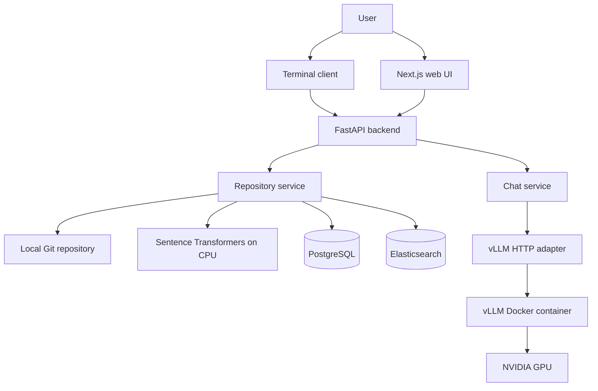

# RepoWren architecture

RepoWren is a modular monolith with three external Docker services. The Python
application owns user interaction, repository safety, CPU embeddings, and
orchestration; vLLM owns chat-model loading and GPU execution, while PostgreSQL
with pgvector stores repository chunks and their JSON metadata and vectors.
Elasticsearch stores the same safe chunk text and location metadata for BM25.

## Current milestone

The current milestone provides a repository-aware local chat path:

1. `repowren-chat` reads a prompt and keeps the active conversation in memory.
   The Next.js UI offers the same flow in a browser.
2. Repository commands register, select, list, read, and search local Git roots.
3. Registration splits safe text into 20-line blocks, embeds them on CPU, and
   fully replaces that repository's chunk rows.
4. Search asks vLLM for one semantic query and up to eight exact-text strings,
   embeds the semantic query once, then asks pgvector for 20 semantic candidates
   and Elasticsearch for 20 lexical candidates concurrently.
5. A small Reciprocal Rank Fusion function combines the two ranked lists by a
   deterministic chunk key and returns the requested number of results.
6. Repository-aware chat prepends the five highest-ranked hybrid chunks to
   validated messages.
7. `ChatService` coordinates the request without depending on Docker details.
8. `VLLMClient` checks readiness and calls vLLM's OpenAI-compatible streaming
   endpoint.
9. Generated text deltas become small newline-delimited API events.
10. The terminal client prints each token as it arrives.

RepoWren and vLLM remain separate processes. The API loads only the small CPU
embedding model; it does not install vLLM, load the chat model, reserve GPU
memory, or depend on Docker libraries. It only needs the HTTP URL in
`VLLM_BASE_URL` to reach chat inference.

## Components

### `repowren/api`

`app.py` creates the FastAPI application, applies database migrations at
startup, and closes owned resources during shutdown. `routes.py` exposes
health, model status, repository tools, and streamed chat. `schemas.py` bounds
messages, paths, searches, result counts, token counts, and temperature.

### `repowren/repositories`

`service.py` owns the repository security boundary. It canonicalizes Git roots,
rejects traversal and symlink escape, respects root `.gitignore`, skips secrets,
binary/generated/model files, and bounds file sizes and result counts. It uses
fixed 20-line chunks so the first implementation is easy to inspect. Repeating
registration performs a complete rebuild rather than incremental hashing. The
same in-memory safe chunks feed PostgreSQL first and Elasticsearch second.

The planner uses the existing vLLM chat adapter with temperature zero and a
small JSON-only prompt. Its output is bounded and validated; malformed JSON
or an unavailable planner falls back to using the original query for both
searches. Search does not compare incompatible cosine and BM25 scores. Each candidate at
one-based rank `r` receives `1 / (60 + r)`, and a chunk present in both lists
receives both contributions. `chunk_key` values such as
`7:src/pricing.py:1:20` identify the same logical chunk across both stores. The
pure RRF function uses stable first-seen ordering only to break exact ties.
The explicit search API includes the validated query plan beside the matches,
and the terminal prints both backend query inputs before the aggregate ranking.

### `repowren/embeddings.py`

The narrow `EmbeddingBackend` protocol keeps repository code independent of a
specific ML library. `SentenceTransformerEmbeddings` lazy-loads
`all-MiniLM-L6-v2` on CPU and returns normalized 384-dimensional vectors.

### `repowren/persistence`

`postgres.py` persists repositories, the active selection, and chunks through a
narrow store interface. Chunk metadata is JSONB and vectors use `VECTOR(384)`.
Search uses exact cosine distance (`<=>`) with no HNSW or IVFFlat index. Packaged
SQL migrations run once and are recorded in `schema_migrations`.

### `repowren/lexical.py`

The narrow `LexicalSearchIndex` protocol contains only initialize, replace,
search, and close operations so offline tests can inject a fake. The production
`ElasticsearchLexicalSearchIndex` uses the official asynchronous client. It
creates or validates one mapping, deletes one repository's old documents,
indexes replacements in bounded bulk batches, refreshes once, and runs boosted
`match_phrase` clauses plus a broad BM25 `match`, all under a repository filter.
It never indexes or stores vectors.

### `repowren/services`

`chat.py` converts inference output into `status`, `token`, `done`, and `error`
events. This keeps the public API independent of vLLM's Server-Sent Events.

### `repowren/inference`

`base.py` defines the narrow interface the chat service needs. `vllm.py` is the
only application module that understands vLLM's OpenAI-compatible protocol.
Network, readiness, and response-format failures become actionable
`InferenceError` messages.

### `repowren/cli.py`

The terminal client is a separate HTTP consumer. It does not import the agent
service or inference implementation, so a future editor interface can use the
same API without changing the backend.

### `web`

The local Next.js application mirrors the terminal client. It lists and selects
registered repositories, streams repository-aware chat, displays the semantic
and exact-text search plan beside RRF-ranked results, and browses safe files.
Its server rewrites `/api/repowren/*` to the configured local FastAPI URL, so no
browser CORS policy or duplicate backend routes are required. Conversation
history remains browser memory only, matching the terminal's local session.

### `compose.yaml`

Docker Compose runs vLLM, the pgvector PostgreSQL image, and a single-node
Elasticsearch image. It grants vLLM one
NVIDIA GPU, maps host port `8001` to vLLM port `8000`, and persists model,
compilation, and database data in named volumes. Elasticsearch uses its own
named volume and a small explicit development heap. Docker Compose commands
provide the lifecycle interface.
`Dockerfile.vllm` derives from the pinned official CUDA 12.9 image and removes
the optional TorchCodec multimedia decoder. RepoWren serves text, and the
current TorchCodec binary is linked against CUDA 13, so retaining it prevents
vLLM from importing on the CUDA 12.9 image.

## Configuration

Process variables take precedence over the ignored `.env` file.

- `VLLM_IMAGE` selects the container image.
- `VLLM_MODEL_ID` selects the served Hugging Face model.
- `VLLM_BASE_URL` tells RepoWren where vLLM is reachable.
- `VLLM_PORT` selects the host-side Docker port.
- `VLLM_MAX_MODEL_LEN` bounds prompt-plus-output context in vLLM.
  The Compose default is 4,096 tokens; a context-window rejection triggers one
  adapter retry with shortened source context and a 128-token completion cap.
- `VLLM_GPU_MEMORY_UTILIZATION` limits the fraction of GPU memory reserved.
- `VLLM_DTYPE` selects the model data type.
- `HF_TOKEN` optionally authenticates gated model downloads.
- `REPOWREN_API_URL` tells the terminal client where the API is reachable.
- `DATABASE_URL` tells the API where PostgreSQL is reachable.
- `EMBEDDING_MODEL_ID` selects the CPU Sentence Transformers model.
- `ELASTICSEARCH_URL` tells the API where Elasticsearch is reachable.
- `ELASTICSEARCH_INDEX` selects the text-only source-chunk index.
- `ELASTICSEARCH_PORT` selects Elasticsearch's host-side Docker port.
- `POSTGRES_USER`, `POSTGRES_PASSWORD`, `POSTGRES_DB`, and `POSTGRES_PORT`
  configure the Compose database service.

## Why Docker is the only vLLM installation path

vLLM requires Linux and a tightly matched Torch/CUDA environment. The official
container packages those dependencies together. RepoWren therefore does not
maintain a second vLLM Python environment or shell scripts inside the user's
Ubuntu distribution.

Docker Desktop still uses a Linux virtualization backend for GPU-enabled
containers on Windows. That infrastructure is managed by Docker rather than by
RepoWren.

## Testing boundaries

Offline tests use fake inference, embedding, storage, and lexical-search
backends. They test repository boundaries, ignored files, LLM plan parsing,
shared chunk identity, RRF ordering, context construction, Elasticsearch
request translation, validation, event ordering, and terminal output without
Docker, a GPU, a database, or a model download.

Hardware validation is intentionally separate:

1. Start PostgreSQL and Elasticsearch and wait for their health checks.
2. Verify one real pgvector query, BM25 query, and application-side RRF merge.
3. Start vLLM when validating repository-aware generation.
4. Start `repowren-api` and check `/health` and `/status`.
5. Run `repowren-chat` and `benchmarks/inference.py`.

## Safety boundary and next milestone

Phase 2 is read-only. Repository tools cannot modify source, execute commands,
or perform Git operations. PostgreSQL and Elasticsearch contain regenerable
copies of safe source chunks for semantic and lexical retrieval. They cannot
share a transaction: PostgreSQL is replaced first, Elasticsearch second, and a
lexical failure is reported clearly. Re-registering performs the simple repair.
Later milestones can add better
chunking and vector indexes, approval-controlled patches and tests, then
approval-controlled Git operations. The terminal client, FastAPI boundary, and
inference interface can remain unchanged as those capabilities grow.
